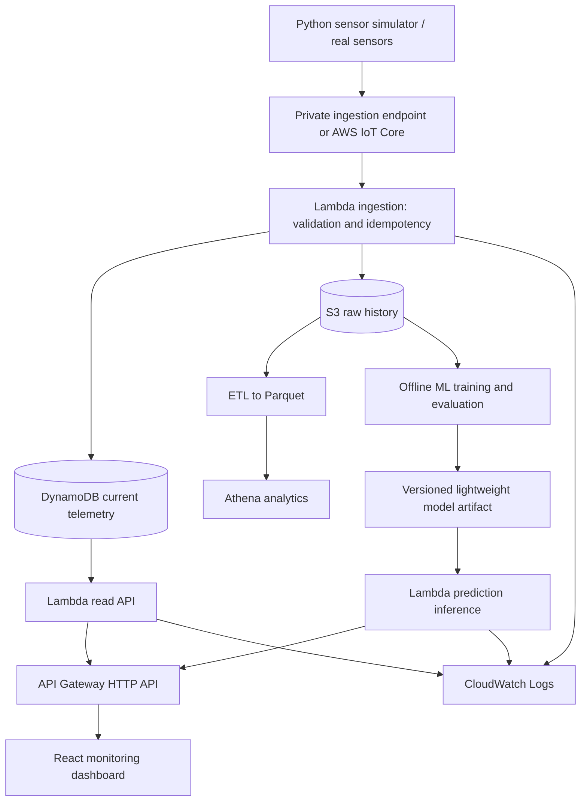

# Planned cloud architecture (not yet deployed)

## Design principles
- Real and simulated data are always distinguishable (`source`).
- Ingestion must authenticate devices, reject malformed events, and handle event replay/idempotency by event_id.
- Raw history is stored in S3; latest readings and query keys are kept in DynamoDB.
- API never exposes direct write access to DynamoDB or S3.
- Model training should use real labeled datasets, with no leakage between time partitions.
- Initial training runs locally; inference will use bounded Lambda memory and execution time.
- Infrastructure as Code (AWS SAM / CloudFormation) will be implemented in the next milestone.
- Never enable public S3 buckets for telemetry or deploy unauthenticated write endpoints.
- Design is a target, not a claim of already deployed services.
